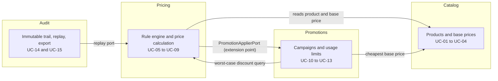
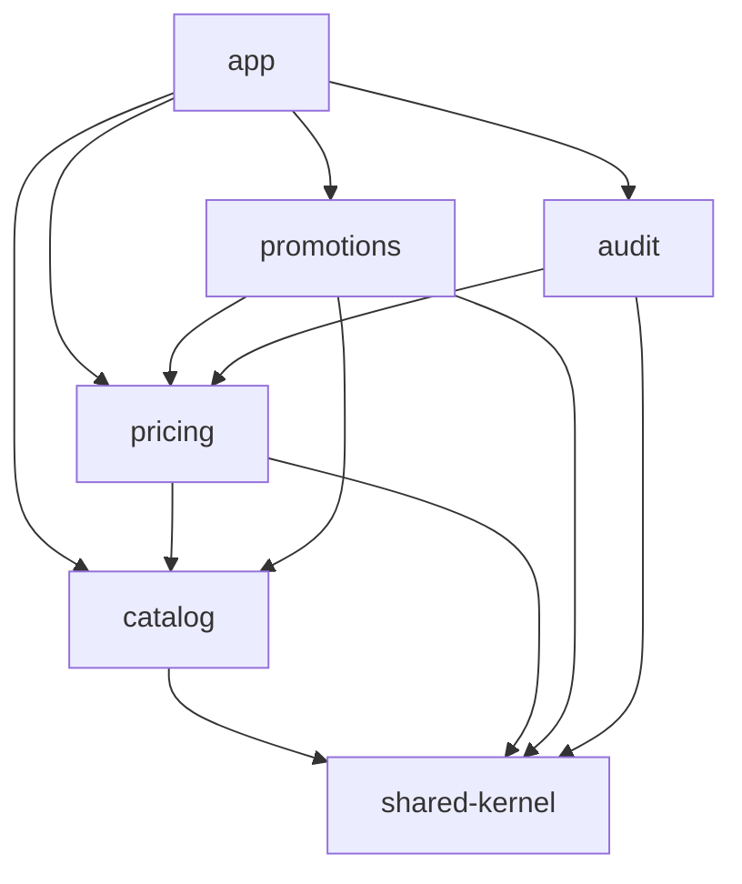
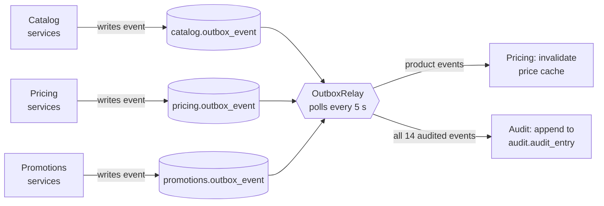

# PriceForge — Pricing & Promotions Platform

[](https://github.com/saalN/pricing-rules-engine/actions/workflows/ci.yml)

A pricing and promotions engine built with **Java 21 and Spring Boot 3**, as a modular monolith of
four hexagonal bounded contexts: **Catalog**, **Pricing**, **Promotions** and **Audit**.

Given a product, a customer and a context, it answers *"what should this customer pay, and why?"*:
it applies pricing rules (by segment, time window, volume, zone), resolves conflicts between them,
layers promotions with usage limits on top, and records an immutable trail that can later be
queried, replayed and exported.

What makes it more than a CRUD exercise:

- **Explainable prices.** Every quote lists the rules and promotions that applied, the ones that
  were excluded and why (`EXCLUDED_BY_HIGHER_PRIORITY`, `EXCLUDED_BY_TIEBREAK`, `LIMIT_REACHED`).
- **A conflict-resolution algorithm shared by two contexts**, deterministic and order-independent.
- **Atomic usage limits** that hold under real concurrency (tested with 100 simultaneous users).
- **An immutable audit trail** fed by events, enforced by the database, with replay of past
  calculations against today's rules.
- **Role-based access** where the Auditor is provably read-only across the whole system.

## Quick start

Requires Java 21, Docker, `curl` and `jq`.

```bash
docker compose up -d        # PostgreSQL 16 + Redis (bound to localhost only)
./gradlew bootRun           # applies every context's Flyway migrations on startup
```

Then, in another terminal, take the guided tour:

```bash
./scripts/demo.sh           # creates products, rules and promotions through the API and narrates
                            # every scenario: conflicts, promotions, limits, audit, RBAC
```

Swagger UI is at <http://localhost:8080/swagger-ui/index.html>. Every endpoint's summary names the
use case it implements (`UC-06: Calculate final price`, …).

> The demo creates everything under a fresh per-run category, so it can be run repeatedly. If you
> have been experimenting by hand, global rules left in the database also apply to the demo's
> products; start from an empty database with `docker compose down -v`.

## Architecture

### Bounded contexts



### Module dependencies

Each context is its own Gradle module. A context may depend only on `shared-kernel` and on another
context's *published ports* — never on its domain or infrastructure. The whole-repo boundary check
is clean.



`shared-kernel` holds what several contexts genuinely share: `Money`, typed ids, `DomainEvent`,
`PricingContext`, `CustomerSegment`, and the `ConflictResolver` algorithm. Inside each context the
layout is `domain` → `application/{port/in, port/out, service, dto}` → `infrastructure/{in, out}`,
with dependencies pointing inward only. See [ARCHITECTURE.md](ARCHITECTURE.md).

### Event flow (transactional outbox, no broker)



Services publish events in the same transaction as their change. One generic relay delivers them
at-least-once to the handlers each context registers; Audit records idempotently on the event id.

## Use cases and endpoints

| UC | Endpoint | Roles |
|---|---|---|
| 01 Create product | `POST /products` | ADMIN |
| 02 Update base price | `PATCH /products/{id}/base-price` | ADMIN |
| 03 Deactivate product | `POST /products/{id}/deactivate` | ADMIN |
| 04 Categorize product | `PATCH /products/{id}/category` | ADMIN |
| 05 Create pricing rule | `POST /pricing-rules` | ADMIN, REVENUE_MANAGER |
| 06 Calculate final price | `POST /price-calculations` | any authenticated role except AUDITOR |
| 07 Conflict resolution | inside UC-06 | — |
| 08 What-if simulator | `POST /price-calculations/simulate` | ADMIN, REVENUE_MANAGER |
| 09 Modify / deactivate rule | `PATCH /pricing-rules/{id}`, `POST /pricing-rules/{id}/deactivate` | ADMIN, REVENUE_MANAGER |
| 10 Create promotion | `POST /promotions` | ADMIN, MARKETING |
| 11 Apply promotion | inside UC-06 | — |
| 12 Activate / expire promotions | scheduler, every minute | — |
| 13 Validate promotion | inside UC-10 | — |
| 14 Price calculation history | `GET /audit/price-calculations`, `…/{id}/replay` | read: all roles; replay: ADMIN, AUDITOR |
| 15 Rule change history | `GET /audit/history/{type}/{id}`, `GET /audit/export` | read: all roles; export: ADMIN, AUDITOR |

## Try it with curl

```bash
BASE=http://localhost:8080
CATEGORY="README-$(date +%s)"      # a fresh category keeps these rules away from other products

token() { curl -s -X POST $BASE/auth/token -H 'Content-Type: application/json' \
  -d "{\"username\":\"$1@priceforge.com\",\"role\":\"$2\"}" | jq -r .accessToken; }
ADMIN=$(token admin ADMIN); MARKETING=$(token marketing MARKETING); AUDITOR=$(token auditor AUDITOR)
post() { curl -s -X POST "$BASE$1" -H "Authorization: Bearer $2" -H 'Content-Type: application/json' -d "$3"; }

# UC-01: a product worth 100 EUR
PRODUCT=$(post /products $ADMIN "{\"sku\":\"LAPTOP-$CATEGORY\",\"name\":\"Laptop\",\"description\":\"15 inch\",
  \"basePriceAmount\":100,\"currencyCode\":\"EUR\",\"category\":\"$CATEGORY\"}" | jq -r .productId)

# UC-05: VIP customers get 20% off products of that category
post /pricing-rules $ADMIN "{\"type\":\"SEGMENT_BASED\",\"segment\":\"VIP\",\"discountType\":\"PERCENTAGE\",
  \"discountValue\":20,\"priority\":10,\"combinationMode\":\"STACKABLE\",\"scopeCategory\":\"$CATEGORY\"}" | jq

# UC-06: what does a VIP customer pay?
USER=$(uuidgen)
post /price-calculations $ADMIN "{\"productId\":\"$PRODUCT\",\"userId\":\"$USER\",\"userSegment\":\"VIP\",
  \"quantity\":1,\"location\":\"URBAN\",\"currency\":\"EUR\"}" | jq

# UC-08: and if we also added a 5% rule? (persists nothing)
post /price-calculations/simulate $ADMIN "{\"productId\":\"$PRODUCT\",\"userId\":\"$USER\",\"userSegment\":\"VIP\",
  \"quantity\":1,\"location\":\"URBAN\",\"currency\":\"EUR\",\"hypotheticalRule\":{\"type\":\"SEGMENT_BASED\",
  \"segment\":\"VIP\",\"discountType\":\"PERCENTAGE\",\"discountValue\":5,\"priority\":5,
  \"combinationMode\":\"STACKABLE\",\"scopeCategory\":\"$CATEGORY\"}}" | jq .finalPriceAmount

# UC-10: a promotion of 10 EUR, 100 uses in total, one per customer
post /promotions $MARKETING "{\"name\":\"Launch\",\"description\":\"10 EUR off\",
  \"validFrom\":\"$(jq -rn 'now-86400|todate')\",\"validUntil\":\"$(jq -rn 'now+86400|todate')\",
  \"globalUsageLimit\":100,\"perUserUsageLimit\":1,\"category\":\"$CATEGORY\",\"discountType\":\"FIXED_AMOUNT\",
  \"discountValue\":10,\"currency\":\"EUR\",\"priority\":10,\"combinationMode\":\"STACKABLE\"}" | jq

# UC-06 again: the rule gives 80, the promotion takes 10 more
post /price-calculations $ADMIN "{\"productId\":\"$PRODUCT\",\"userId\":\"$USER\",\"userSegment\":\"VIP\",
  \"quantity\":1,\"location\":\"URBAN\",\"currency\":\"EUR\"}" | jq '{finalPriceAmount, appliedRules, appliedPromotions}'

# UC-14 / UC-15 (events reach Audit within a few seconds): history, replay and export as the Auditor
sleep 6
curl -s "$BASE/audit/price-calculations?productId=$PRODUCT" -H "Authorization: Bearer $AUDITOR" | jq '.items[] | {eventType, occurredAt, userId}'
curl -s "$BASE/audit/history/PRODUCT/$PRODUCT" -H "Authorization: Bearer $AUDITOR" | jq '.[] | {eventType, newState}'
curl -s "$BASE/audit/export?format=CSV&productId=$PRODUCT" -H "Authorization: Bearer $AUDITOR"
```

## How prices are computed

1. **Pricing rules** (time window, segment, volume, zone) that match the context and the product's
   scope are collected.
2. **Conflicts are resolved** (UC-07) by one algorithm, shared with Promotions:

   | Situation | Outcome |
   |---|---|
   | Different priorities | Higher priority first; an `EXCLUSIVE` item excludes every lower-priority one (`EXCLUDED_BY_HIGHER_PRIORITY`) |
   | Same priority, both `STACKABLE` | Both apply, each computed on the same starting price, so order cannot matter |
   | Same priority, one `EXCLUSIVE` | The `EXCLUSIVE` wins; the other is `EXCLUDED_BY_TIEBREAK` and a `RuleConflictDetected` event is raised |
   | Same priority, both `EXCLUSIVE` | The one created first wins; the other is `EXCLUDED_BY_TIEBREAK` |

3. **Promotions** apply on the resulting price with the same algorithm. Each one atomically checks
   and increments its global and per-user usage counters; a promotion that reaches its global limit
   becomes `EXHAUSTED` in that same operation.
4. The price never reaches zero or below: it is floored at the smallest payable amount and a
   conflict is recorded. UC-13 additionally rejects, at creation, any promotion that could drive
   the cheapest product in scope to zero when combined with the worst-case active rules.
5. Every figure is expressed in the currency's own decimals (half-up), each discount line is
   rounded, and the lines add up exactly to the final price.

## Testing strategy

More than 270 tests, written at the level where each kind of bug can be seen:

| Level | What | Tools |
|---|---|---|
| Domain | Rules, conflict algorithm, money rounding. No Spring, no mocks | JUnit 5, AssertJ |
| Application | Services against hand-written in-memory fake ports (not Mockito) | JUnit 5 |
| Infrastructure | Persistence adapters against a real PostgreSQL; controllers with `@WebMvcTest` | Testcontainers |
| End to end | Real HTTP, real JWTs, real Postgres and Redis | `@SpringBootTest`, Testcontainers |

The end-to-end suite includes a regression with conflicts on both layers (hand-computed expected
prices), a high-concurrency test of the usage limits (100 simultaneous users against a limit of 25,
one user flooding a per-user limit, several promotions locked in priority order), an OpenAPI
contract test that pins every endpoint to its use case, and a guard that walks every application
service and requires it to deny the Auditor unless it is explicitly read-only.

```bash
./gradlew build            # everything (needs a Docker daemon for Testcontainers)
./gradlew :catalog:test    # one module
```

The concurrency test earned its keep: it found that, with Spring's default Open-Session-In-View,
about ten simultaneous price calculations exhausted the connection pool and every request stalled
until it timed out. See `spring.jpa.open-in-view` in `application.yml`.

## Design decisions

- **A modular monolith, not microservices.** Four contexts with strict boundaries give the
  separation that matters (independent modules, ports between them, enforced dependency rule)
  without distributed-systems costs a project of this size would not repay. The seams are real, so
  extracting one later is a matter of replacing an adapter.
- **One PostgreSQL schema per context, with its own Flyway history.** A context owns its tables and
  migrations; nothing reads another context's tables. Cross-context data flows through ports and
  events.
- **Transactional outbox instead of a message broker.** Events are written in the same transaction
  as the change, so they are never lost or published for a change that rolled back. A single
  generic relay delivers them at-least-once; consumers are idempotent. A broker can replace the
  relay without touching a service.
- **Authorization with `@PreAuthorize` on application services, not controllers.** The rule then
  holds for every way into a use case (HTTP, scheduler, another context), and the HTTP layer only
  has to say "authenticated". A test proves the Auditor cannot write anywhere.
- **A shared conflict algorithm in the shared kernel.** Pricing and Promotions need the same
  priority/tie-break semantics, and diverging would be a correctness bug. It deliberately knows
  nothing about money; each context applies its own effect.
- **Atomic usage limits with row locks.** The global and per-user counters live in two tables, so a
  single `UPDATE` is not enough; `SELECT … FOR UPDATE` on the promotion row serialises concurrent
  applications. Promotions are always locked in one deterministic order (by priority, then by id),
  which rules out deadlocks; a concurrency test with tied and untied priorities covers it.
- **Audit as an append-only table.** Immutability is enforced by a trigger, not by convention.
  Each price calculation stores its full `contextSnapshot`, so it can be replayed later.
- **Redis caches only the pricing-rule part of a quote** (short TTL, invalidated by Catalog events).
  Promotions are never cached: their limits must be checked and consumed on every request.

## Security notes

- **`POST /auth/token` is a demo utility.** It issues a token for any role without credentials, so
  the RBAC of every use case can be exercised. The spec defines no login flow.
- **The `prod` profile refuses to start with development shortcuts.** With
  `SPRING_PROFILES_ACTIVE=prod` the demo endpoint is off, Swagger UI and the API docs are off,
  `JWT_SECRET` is mandatory, and the application fails at startup if the secret is the committed
  development default, shorter than 32 characters, or the demo endpoint is still enabled.
- **Local infrastructure is bound to `127.0.0.1`** in `docker-compose.yml`; the credentials in
  `application.yml` and the compose file are local-development values.

Known limitations, deliberately out of scope here: no rate limiting; `userId` in a price request is
supplied by the caller, so a caller can consume another user's per-user promotion limit (the API
client is trusted, as in the functional spec); and the audit replay re-runs the pricing rules only,
so a calculation that originally used a promotion can report a difference even if nothing changed.

## Stack

Java 21 · Spring Boot 3.5 · Spring Security (stateless JWT, HS256) · Spring Data JPA · PostgreSQL 16
· Flyway · Redis · springdoc-openapi · JUnit 5 · AssertJ · Testcontainers · Gradle (Kotlin DSL).
